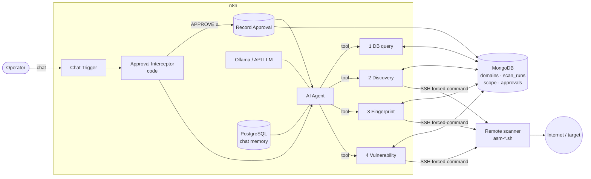

# Design guide

How the ASM pipeline is built, why it is built that way, and where to change things.

## 1. Design principles

1. **The LLM orchestrates; code enforces.** The agent decides *what to do next* and writes the final answer. It never decides *whether it is allowed to scan*. Scope and approval are enforced by deterministic nodes and re-checked inside every scan tool.
2. **MongoDB is the source of truth, the scanner is stateless.** Each stage reads its targets from MongoDB and writes its results back. The scanner keeps no state between calls, so any stage can be re-run, and a scanner VM can be replaced at will.
3. **Narrow, auditable SSH surface.** n8n can run exactly three scripts on the scanner, with validated arguments (forced command + input regexes on both sides).
4. **Idempotent by construction.** Every write is an upsert keyed by a natural key (`host`, `scan_id`, `domain`). Re-running a stage never duplicates data.
5. **Tools return summaries, not data dumps.** Raw results go to MongoDB; the LLM only receives compact summaries (keeps small local models usable and prevents data from flooding the context).
6. **Fail loudly, keep partial results.** Tool failures surface as readable errors to the agent; the scripts keep partial output when one tool times out.

## 2. Components



| Component | Responsibility |
|-----------|----------------|
| **Chat Trigger** | Entry point (chat panel). `public:false` by default. |
| **Approval Interceptor** (Code) | Looks at the raw user message *before* the LLM. Only `^APPROVE <valid-domain>$` yields `isApproval=true`. |
| **Record Approval** (MongoDB upsert) | Writes `{domain, status:"granted", expires_at = now+30 min}` to `approvals`. Only reachable from the interceptor. |
| **AI Agent** | Tools agent with Postgres chat memory (session = chat session). System prompt defines the workflow and the answer format. |
| **Tool workflows 1–4** | Each is an n8n sub-workflow called through a *Call n8n Workflow Tool* node; input is only `domain`. |
| **Remote scanner** | Runs the open-source tools and normalises output to **one line of JSON** on stdout. |
| **MongoDB** | Inventory (`domains`), audit/trend (`scan_runs`), allow-list (`scope`), approvals (`approvals`, TTL-expiring). |

## 3. Sequence of a scan

```mermaid
sequenceDiagram
  actor U as Operator
  participant N as n8n (interceptor + agent)
  participant DB as MongoDB
  participant S as Scanner (SSH)
  U->>N: "scan example.com"
  N->>DB: check_previous_scans (scan_runs, domains)
  DB-->>N: last scan time, counts, stored verdict
  N-->>U: history + "reply APPROVE example.com"
  U->>N: "APPROVE example.com"
  N->>DB: upsert approvals{example.com, granted, +30min}  (interceptor, not LLM)
  N->>N: agent sees "[GATE: approval recorded …]"
  Note over N,DB: run_discovery
  N->>DB: scope allow-list? approval valid? -> consume approval, insert scan_run(stage=discovery)
  N->>S: asm-discover.sh example.com
  S-->>N: JSON {subdomains, dns, live}
  N->>DB: upsert domains (key=host) · scan_run.stage=discovery_done
  Note over N,DB: run_fingerprinting (gate: running scan at discovery_done)
  N->>DB: read live hosts of this scan
  N->>S: base64(hosts) | asm-fingerprint.sh --stdin
  S-->>N: JSON {http, tls, nmap per host}
  N->>DB: update http / tls / port_scanning · stage=fingerprint_done
  Note over N,DB: run_vulnerability_scan (gate: fingerprint_done)
  N->>S: base64(urls) | asm-vuln.sh --stdin
  S-->>N: JSON {findings}
  N->>DB: update nuclei · compute verdict · scan_run.status=completed
  N-->>U: verdict + why + assets + services + findings
```



## 4. Control gates (the security model)

| Gate | Enforced by | Cannot be bypassed by the LLM because… |
|------|-------------|----------------------------------------|
| **Input validation** | `Validate Domain` Code node in every tool; regex also in the shell scripts | Invalid strings (shell metacharacters, URLs, IPs) are rejected before any command is built. |
| **Scope allow-list** | `Scope Check` + `Gate` in *Discovery* against `scope` collection | The collection is only writable via `scripts/add-scope.sh` (operator) — no tool or workflow node writes to it. |
| **Human approval** | `Approval Interceptor` → `approvals`; checked + consumed in *Discovery* `Gate` | The approval record is created by code from the *user's literal message*. The LLM has no tool that writes `approvals`. It is single-use and TTL-expired (Mongo TTL index). |
| **Stage ordering** | `Gate` in *Fingerprint* / *Vulnerability* | They require a `running` scan_run (created only by Discovery after approval) at the right `stage`, younger than 6 h. |
| **SSH forced command** | `asm-ssh-gate.sh` in `authorized_keys` (+ `restrict`) | Even a compromised n8n key can only run the three scripts with regex-valid arguments. |
| **Scan safety defaults** | `asm.conf` | CDN-edge and private IPs are not port-scanned; nuclei excludes `dos,fuzz,bruteforce,intrusive`; rate limits; host cap 500. |

Known gap (by design): the approval proves *a human typed APPROVE in this n8n*, not who they are. Protect n8n access (owner login, TLS, SSO) accordingly.

## 5. Data model

### `domains` — one document per host (the asset inventory)

Unique index on `host`. Written in three stages; each stage `$set`s **only its own fields**, so a later stage never wipes an earlier one:

| Stage | Fields written |
|-------|----------------|
| Discovery | `host, root_domain, first_seen, last_seen, last_scan_id, status, dns, discovery` |
| Fingerprint | `http, tls, port_scanning, fingerprint_scan_id` |
| Vulnerability | `nuclei` |

```jsonc
{
  "host": "api.example.com", "root_domain": "example.com",
  "first_seen": ISODate("…"),        // set once, preserved on every re-scan
  "last_seen":  ISODate("…"), "last_scan_id": "scan-…",
  "status": "live",                  // live | resolved | unresolved
  "dns": { "a": [], "aaaa": [], "cname": [], "rcode": "NOERROR", "resolved": true,
           "dangling_cname": false, "updated_at": "…" },
  "discovery": { "live_probe": [ { "url", "status_code", "title", "webserver", "port", "scheme" } ], "scan_id": "…" },
  "http": { "services": [ { "url", "final_url", "scheme", "port", "status_code", "title", "webserver",
                            "tech": [], "content_type", "content_length", "cdn", "cdn_name" } ] },
  "tls":  { "certificates": [ { "port", "version", "cipher", "subject_cn", "subject_an", "issuer_cn",
                                "not_before", "not_after", "days_to_expiry", "expired", "self_signed",
                                "mismatched", "untrusted", "wildcard", "sha256" } ] },
  "port_scanning": { "ips": [ { "ip", "cdn", "scanned", "skip_reason",
                                "open_ports": [ { "port", "protocol", "service", "product", "version", "extrainfo", "cpe" } ] } ],
                     "ports_profile": "21,22,…", "tool": "nmap -sT -sV --version-light", "scanned_at": "…" },
  "nuclei": { "scan_id", "findings": [ { "template_id", "name", "severity", "type", "matched_at",
                                         "tags", "description", "reference", "cve", "cvss_score" } ],
              "counts": { "critical":0, "high":0, "medium":0, "low":0, "info":0, "unknown":0 }, "total": 0,
              "scanned_urls": [], "severity_filter": "…", "templates_version": "…", "scanned_at": "…" }
}
```

**Idempotency rules**

* Same input → same document: the host list is de-duplicated (case-folded, wildcard prefix removed) on the scanner *and* in n8n; the upsert key is `host`.
* `first_seen` is looked up from the existing document and written back unchanged; only `last_seen` moves.
* Sections are replaced as a whole (latest snapshot); history lives in `scan_runs`.
* The vulnerability stage writes a `nuclei` section for **every** live host (even with 0 findings) so "scanned and clean" is distinguishable from "never scanned".
* `status` reflects the *latest* scan (a host that stops answering becomes `resolved`/`unresolved`). Hosts not seen at all are left untouched — compare `last_seen`.

### `scan_runs` — one document per approved scan

`scan_id` (unique), `root_domain`, `status` (`running` → `completed`), `stage` (`discovery` → `discovery_done` → `fingerprint_done` → `completed`), `started_at`, `approved_at`, `approval_session`, `matched_scope`, per-stage summaries, and at the end `summary` (verdict, reasons, stats, top findings). This is the **trend** table: `db.scan_runs.find({root_domain}).sort({started_at:1})`.

### `scope` and `approvals`

* `scope`: `{domain, active, note, added_at}` — written only by the operator script.
* `approvals`: `{domain (unique), status: granted|consumed, granted_at, expires_at, session_id, consumed_at}` — TTL index on `expires_at` removes them after expiry.

## 6. Workflow walkthrough

### 00 Orchestrator
`Chat Trigger → Approval Interceptor → Is Approval? →(true) Record Approval → AI Agent` and `(false) → AI Agent`.
Sub-nodes on the agent: *Ollama Chat Model*, *Postgres Chat Memory* (session key = chat session id), and the four tools. When an approval was recorded, the agent's input gets an extra line `[GATE: approval recorded for <domain> …]`; the system prompt allows scan tools only when that line is present (and the tools check the database anyway).

### 01 DB Query — `check_previous_scans`
`Validate Domain → Find Last Scan Run → Find Domain Assets → Build History Report`.
Returns `previously_scanned`, `last_scan_time`, `last_scan_age_hours`, last run status, asset count, the stored exposure summary and a recommendation (reuse vs refresh).

### 02 Discovery — `run_discovery`
`Validate → Find Scope → Scope Check → Find Approval → Gate → Consume Approval → Prepare Scan Run → Create Scan Run → Run Discovery (SSH) → Find Existing Assets → Normalize & Merge → Upsert Hosts → Discovery Summary → Update Scan Run → Final Output`.

### 03 Fingerprint — `run_fingerprinting`
`Validate → Find Active Scan Run → Gate → Find Live Hosts → Build Target List (base64) → Run Fingerprint (SSH) → Normalize Fingerprint → Update Hosts → Fingerprint Summary → Update Scan Run → Final Output`.

### 04 Vulnerability — `run_vulnerability_scan`
`Validate → Find Active Scan Run → Gate → Find Live Hosts → Build URL List → Run Nuclei (SSH) → Normalize Nuclei → Update Nuclei Section → Find All Assets → Exposure Summary → Complete Scan Run → Final Output`.

**Patterns used throughout**

* *Mongo write → Code → next step*: MongoDB write nodes output the driver result, not your data, so a Code node re-reads what it needs with `$('NodeName')`.
* *Sentinel item* `{host:"__none__"}`: when a stage has nothing to update, an update node still gets one harmless item (no upsert ⇒ no write) so the chain continues to the summary.
* *Find nodes use `alwaysOutputData`* so "no result" is an empty item rather than a dead branch.
* *Helper fields prefixed `_`* (e.g. `_is_new`) exist only in n8n memory; Mongo update nodes list the exact fields to persist.

## 7. Scanner contract

| Call (exact string the workflow sends) | Does | stdout (one JSON line) |
|----------------------------------------|------|------------------------|
| `/opt/asm/bin/asm-discover.sh <domain>` | subfinder + assetfinder (+ shuffledns if enabled) → merge/filter to the domain → dnsx (wildcard-filtered) → httpx probe | `{domain, subdomains[], dns[], live[], tools{}, warnings[]}` |
| `echo '<base64 hosts>' \| base64 -d \| /opt/asm/bin/asm-fingerprint.sh --stdin` | httpx (tech, CDN, TLS, redirects) → pick public non-CDN IPv4s → `nmap -Pn -sT -sV --version-light` on a targeted port list | `{hosts[{host, http_services, tls_certificates, ips[{open_ports}]}], nmap{…}, warnings[]}` |
| `echo '<base64 urls>' \| base64 -d \| /opt/asm/bin/asm-vuln.sh --stdin` | `nuclei -jsonl` with severity filter and safe tag exclusions | `{findings[], scanned_urls, templates_version, severity_filter, warnings[]}` |

Rules: stdout is JSON only; logs go to stderr; non-zero exit = fatal; partial results are kept when a single tool fails (a `warnings[]` entry is added). Base64 is used for lists because it is shell-safe and survives the SSH command line. `asm_normalize.py` (stdlib only) is the only place that knows the tools' raw output formats — adapt it if a tool changes its JSON.

## 8. Exposure scoring (deterministic)

Computed in JavaScript from stored data (same code in workflow 1 and 4), then relayed by the agent.

| Evidence | Level |
|----------|-------|
| Nuclei `critical` | critical |
| Nuclei `high`, or a **high-risk** port open (Telnet, SMB, MSSQL, Oracle, MySQL, PostgreSQL, RDP, VNC, Redis, Memcached, MongoDB, Elasticsearch, CouchDB, NFS, rpcbind, MS-RPC, NetBIOS, Docker API) | high |
| Nuclei `medium`, or a **medium-risk** port (FTP, POP3, IMAP, LDAP, Kibana, 9090) | medium |
| Nuclei `low`, SSH/SMTP/DNS reachable, TLS issue (expired, self-signed, mismatch, untrusted, ≤14 days), dangling CNAME | low |
| Live web hosts, nothing else | info |
| Nothing live | none |

| Level | Verdict | Meaning |
|-------|---------|---------|
| critical / high / medium | `EXPOSED` | At least one medium-or-higher issue |
| low | `LIMITED_EXPOSURE` | Hygiene issues only |
| info | `INTERNET_FACING_ONLY` | Public web assets, nothing found in this profile |
| none | `NO_EXPOSURE_FOUND` | No live hosts |

Every verdict carries `reasons[]` and a `caveat`: absence of findings is bounded by the enabled sources, the port list and the Nuclei profile.

## 9. Failure modes

| Failure | Behaviour | Recovery |
|---------|-----------|----------|
| SSH/tool failure | Tool throws a readable error; agent reports the stage; `scan_run` stays `running` | Approve again → new scan_run; stale `running` (>6 h) is ignored |
| One tool in a script fails/times out | Partial results kept, `warnings[]` returned | Re-run; adjust `asm.conf` |
| LLM calls a tool out of order / unapproved | Tool answers `REFUSED: …` | Agent relays it |
| n8n restarts mid-scan | Execution lost; Mongo has whatever stages completed | Re-approve and re-run |
| Approval expired | `REFUSED: no valid user approval` | Type `APPROVE <domain>` again |
| Two simultaneous scans of one domain | Last-writer-wins on sections; both `scan_runs` recorded | Avoid; not locked (see §10) |

## 10. Design decisions and alternatives

* **Why not let the agent write the approval?** An LLM can be talked into anything (prompt injection from scan data, a confused user message). A code node reading the literal user message is a hard boundary.
* **Why one document per host instead of per domain?** Natural unit for upserts, queries ("all hosts with Redis open"), and per-host history; the domain-level view is an aggregation / the `scan_runs.summary`.
* **Why scripts on the scanner instead of long SSH one-liners in n8n?** Testability, normalisation close to the tools, and a tiny, lockable command surface.
* **Why nmap `-sT`?** Works as an unprivileged user (no raw sockets/capabilities needed on the scanner). Switch to `-sS` if you run as root.
* **Why not scan CDN IPs?** They belong to the CDN, are shared with other customers, and are usually outside your authorisation.
* **Possible hardening:** per-user approvals (n8n SSO + user id in the approval), a lock document per domain, Slack/Teams approval via the n8n *Send and Wait* feature, signed approvals, scanner egress allow-list.

## 11. Extending

* **New stage** (e.g. screenshot, subdomain-takeover check): add a script + normaliser mode, a sub-workflow with the same `Validate → Gate → … → Final Output` shape, a `toolWorkflow` node on the agent, and a line in the system prompt. Add its stage name to the gate arrays.
* **Different LLM**: replace the model sub-node; keep temperature 0.
* **Different scanner**: anything that honours the three-command contract works (e.g. a container instead of a VM).
* **Notifications / dashboards**: trigger on `scan_runs` completion; the `summary` object is designed to be sent as-is.
